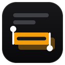

<div align="center">



# Pasteur

**Select, copy, search. Right where you read.**

Pasteur copies selected text to the clipboard and offers search, highlights and link copying in a small bubble next to your selection. Everything runs in your browser. There is no server and no telemetry.

[Türkçe](README.tr.md)


</div>

<br>

## What you can do

| Area | What you can do |
|---|---|
| **Automatic copy** | Selected text is copied as soon as you release the mouse or finish a keyboard selection. Turn it off to get a Copy button instead. |
| **Text fields** | Copy selections inside inputs and textareas too (optional). Password fields are never copied. |
| **Quick search** | Search the selection with Google, DuckDuckGo, Bing or Yandex from the bubble. |
| **Highlights** | Mark text in yellow, green, pink or blue. Highlights are saved per page and come back when you return. |
| **Highlight navigation** | Jump between the highlights of a page with up/down buttons, with a position counter. |
| **Links** | When the selection contains a link, the bubble offers "copy text" or "copy link". Nothing is copied silently. |
| **Position** | Show the bubble above or below the selection, next to the cursor, in any screen corner, or at a custom offset. |
| **Site exclusion** | Disable Pasteur on specific domains, subdomains included. |
| **Restricted pages** | Optionally unlock right click, text selection and copying on pages that block them. Off by default. When a page blocks a right click or a selection, the toolbar icon shows a badge and the popup offers an Unlock button for that page. |

**And also:**

- Larger buttons on touch screens
- The bubble lives in a Shadow DOM, so page styles cannot affect it
- Settings in a toolbar popup or in the gear button of the bubble

## Getting started

1. **Load** the extension as described in [Building from source](#building-from-source).
2. **Select** any text on a page. The bubble appears.
3. **Use** its buttons to copy, copy the link, search, highlight or open the settings.

## Requirements

- Firefox 142 or later, or Chrome
- Node.js, only if you build or run from source

## Project structure

Plain scripts without a build step. The content scripts share one scope and are loaded in the order listed in `manifest.json`.

- `shared/`: settings defaults and helpers (`settings.js`), `data-i18n` filler (`i18n.js`). Used by the content scripts and the popup.
- `highlight/`: highlight engine. Storage and painting (`store.js`), text-to-Range mapping (`anchor.js`), up/down navigation (`nav.js`), nested frames (`frames.js`), restore on load (`init.js`). Colors are in `highlight.css`.
- `content/`: the in-page bubble. Shared state, bubble styles, icons, DOM and behavior, clipboard, selection handling, in-page settings panel, highlight actions, page events and start-up (`main.js`, loaded last).
- `popup.html` + `popup.css` + `popup/`: settings popup, used in the toolbar and in the in-page panel. Page bridge, settings form, highlights card, site switch and start-up.

## Questions

**Does it send my data anywhere?**
No. Settings are stored in the browser's sync storage. Highlights are stored locally on your device. See [PRIVACY.md](PRIVACY.md).

**Why is the pen missing inside text fields?**
Highlights cannot be made inside input and textarea fields, so the pen is hidden there.

**The bubble does not appear.**
Check that Pasteur is enabled, that the site is not excluded, and that the selection is at least the minimum length set in the settings.

## Reporting problems

If something goes wrong, open an [issue](issues/new/choose) and include your browser and its version, the page type and the error message from the console.

## Building from source

Requires Node.js. Dependencies are only needed for the web-ext tools.

```bash
npm install
npm start
npm run lint
npm run build
```

- **Firefox:** `npm start` opens Firefox with a temporary profile. If Firefox is in a custom location, run `npx web-ext run --source-dir . --firefox "path\to\firefox.exe"`. To load it by hand, open `about:debugging#/runtime/this-firefox`, choose Load Temporary Add-on and select `manifest.json`.
- **Chrome:** `npm run start:chrome` opens Chrome with a temporary profile. To load it by hand, open `chrome://extensions`, turn on Developer mode, choose Load unpacked and select the project folder.

## License

MIT
