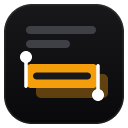

<div align="center">



# Pasteur

**Seçin, kopyalayın, arayın. Okuduğunuz yerde.**

Pasteur, seçtiğiniz metni panoya kopyalar ve seçiminizin yanındaki küçük bir baloncukta arama, vurgulama ve bağlantı kopyalama sunar. Her şey tarayıcınızda çalışır. Sunucu yoktur, telemetri toplanmaz.

[English](README.md)


</div>

<br>

## Neler yapabilirsiniz

| Alan | Yapabilecekleriniz |
|---|---|
| **Otomatik kopyalama** | Fareyi bıraktığınızda ya da klavyeyle seçimi bitirdiğinizde metin hemen kopyalanır. Kapatırsanız bunun yerine Kopyala düğmesi çıkar. |
| **Metin alanları** | Input ve textarea içindeki seçimleri de kopyalayabilirsiniz (isteğe bağlı). Şifre alanları asla kopyalanmaz. |
| **Hızlı arama** | Baloncuktan seçili metni Google, DuckDuckGo, Bing veya Yandex ile arayın. |
| **Vurgular** | Metni sarı, yeşil, pembe veya mavi ile işaretleyin. Vurgular sayfa bazında saklanır, sayfaya döndüğünüzde geri gelir. |
| **Vurgular arası gezinme** | Yukarı/aşağı düğmeleriyle sayfadaki vurgular arasında atlayın, konum sayacı görünür. |
| **Bağlantılar** | Seçim bir bağlantı içeriyorsa baloncuk "metni kopyala" ya da "bağlantıyı kopyala" seçeneği sunar. Sessizce kopyalama yapılmaz. |
| **Konum** | Baloncuğu seçimin üstünde ya da altında, imlecin yanında, ekranın herhangi bir köşesinde veya özel bir kaydırmayla gösterin. |
| **Site hariç tutma** | Pasteur'ı belirli alan adlarında kapatın, alt alan adları dahil. |

**Ayrıca:**

- Dokunmatik ekranlarda daha büyük düğmeler
- Baloncuk Shadow DOM içinde çalışır, sayfa stilleri onu etkilemez
- Ayarlar araç çubuğu popup'ında ya da baloncuğun dişli düğmesinde

## Başlarken

1. [Kaynaktan derleme](#kaynaktan-derleme) bölümünde anlatıldığı gibi eklentiyi **yükleyin**.
2. Bir sayfada herhangi bir metni **seçin**. Baloncuk görünür.
3. Düğmelerle kopyalayın, bağlantıyı kopyalayın, arayın, vurgulayın ya da ayarları açın.

## Gereksinimler

- Firefox 142 veya üstü, ya da Chrome
- Node.js, yalnızca kaynaktan derleyip çalıştıracaksanız

## Proje yapısı

Derleme adımı olmayan düz betikler. İçerik betikleri tek bir kapsamı paylaşır ve `manifest.json`'da listelendiği sırayla yüklenir.

- `shared/`: ayar varsayılanları ve yardımcılar (`settings.js`), `data-i18n` doldurucu (`i18n.js`). İçerik betikleri ve popup ortak kullanır.
- `highlight/`: vurgu motoru. Saklama ve boyama (`store.js`), metin ile Range eşleme (`anchor.js`), yukarı/aşağı gezinme (`nav.js`), gömülü çerçeveler (`frames.js`), yüklemede geri getirme (`init.js`). Renkler `highlight.css` içinde.
- `content/`: sayfadaki baloncuk. Ortak durum, baloncuk stili, ikonlar, DOM ve davranış, pano, seçim işleme, sayfa içi ayar paneli, vurgu eylemleri, sayfa olayları ve başlangıç (`main.js`, en son yüklenir).
- `popup.html` + `popup.css` + `popup/`: ayar popup'ı, araç çubuğunda ve sayfa içi panelde kullanılır. Sayfa köprüsü, ayar formu, vurgular kartı, site anahtarı ve başlangıç.

## Sorular

**Verilerim bir yere gönderiliyor mu?**
Hayır. Ayarlar tarayıcının senkronizasyon deposunda tutulur. Vurgular cihazınızda yerel olarak saklanır.

**Metin alanlarının içinde kalem neden yok?**
Input ve textarea alanlarının içinde vurgu yapılamadığı için kalem orada gizlenir.

**Baloncuk görünmüyor.**
Pasteur'ın açık olduğunu, sitenin hariç tutulmadığını ve seçimin ayarlarda belirlenen minimum uzunlukta olduğunu kontrol edin.

## Sorun bildirme

Bir sorun çıkarsa bir [issue](issues/new/choose) açın; tarayıcınızı ve sürümünü, sayfa türünü ve konsoldaki hata mesajını ekleyin.

## Kaynaktan derleme

Node.js gerekir. Bağımlılıklar yalnızca web-ext araçları için gerekir.

```bash
npm install
npm start
npm run lint
npm run build
```

- **Firefox:** `npm start` komutu Firefox'u geçici bir profille açar. Firefox özel bir konumdaysa `npx web-ext run --source-dir . --firefox "yol\firefox.exe"` komutunu çalıştırın. Elle yüklemek için `about:debugging#/runtime/this-firefox` sayfasını açın, "Geçici Eklenti Yükle" seçeneğiyle `manifest.json` dosyasını seçin.
- **Chrome:** `npm run start:chrome` komutu Chrome'u geçici bir profille açar. Elle yüklemek için `chrome://extensions` sayfasını açın, Geliştirici modunu etkinleştirin, "Paketlenmemiş öğe yükle" ile proje klasörünü seçin.

## Lisans

ISC
